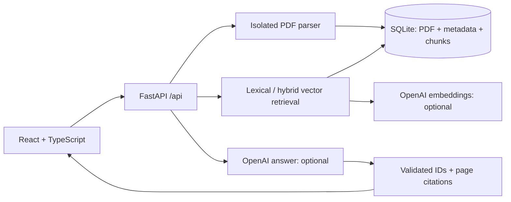

# LinguaSearch

[English](README.md) | [简体中文](README.zh-CN.md)

**Your documents. Your language. Answers you can trace.**

A portfolio-ready full-stack document search and retrieval-augmented question-answering workspace. Built with React, TypeScript, FastAPI, and SQLite. Start without a model key, then connect OpenAI for multilingual semantic retrieval and grounded answers.

[](https://github.com/tangzhemilytt-crypto/Lingua-search/actions/workflows/ci.yml)


## What works

- Responsive knowledge dashboard, document library, search, and question-answering views.
- Upload text-based PDFs, inspect original extracted passages, rename, download, and delete documents.
- Real SQLite persistence for PDFs, metadata, chunks, and cached embedding vectors; atomic deletion with cascading passage cleanup.
- Page-aware chunking (1,100 characters with 150-character overlap), document-scoped retrieval, and clickable citations linking to original page text.
- **AI mode:** multilingual embeddings + weighted semantic/lexical ranking, synthesized answers in a selected language, citation-ID validation, and explicit insufficient-evidence handling.
- **Offline mode:** Unicode-aware lexical retrieval (including Chinese character matching) and original evidence excerpts. No fake AI responses, no API bill. The bilingual samples make it easy to explore; offline mode does **not** translate arbitrary queries.
- Production token gate, bounded uploads/isolated PDF parsing, deduplication, rate limiting, same-origin security headers, non-root Docker image, tests, and GitHub Actions.

## Run locally

Requirements: Python 3.11+ (tested with 3.13), Node.js 24, pnpm 11.25.0.

```sh
git clone https://github.com/tangzhemilytt-crypto/Lingua-search.git
cd Lingua-search
cp .env.example .env
python3 -m venv .venv
source .venv/bin/activate
pip install -r requirements.lock
corepack enable
corepack prepare pnpm@11.25.0 --activate
cd frontend
pnpm install --frozen-lockfile
pnpm run build
cd ..
python -m uvicorn src.app:app --host 127.0.0.1 --port 8000
```

Open **http://localhost:8000**. Three clearly marked synthetic sample documents are seeded once. No API key is required. For frontend development, run `pnpm dev` inside `frontend` in a second terminal (port 5173; requests proxy to backend port 8000).

To enable AI, set `OPENAI_API_KEY` in `.env` and restart the backend. Defaults are `text-embedding-3-small` and `gpt-4.1-mini`; your account must have access to both. Model configuration follows the official [Embeddings API](https://developers.openai.com/api/reference/resources/embeddings/methods/create) and [Chat Completions API](https://developers.openai.com/api/reference/resources/chat/subresources/completions/methods/create). Keys stay server-side. First search after enabling AI embeds any offline documents and caches their vectors.

## A two-minute demo

1. Open the dashboard and inspect “A field guide to RAG.”
2. In Explore & search, search `检索` and open a matching page.
3. Ask `How does language shape identity?` and follow citation 1 to its original passage.
4. Upload a text PDF; rename it and select it as the search scope.
5. With AI enabled, ask a Chinese question about an English PDF. Explain how shared embedding space supports cross-language retrieval.

The sample documents are authored demo text, not published papers. Their page numbers describe sample sections; uploaded PDF citations use actual 1-based PDF pages. Scan-only PDFs are rejected with an OCR explanation.

## Architecture



`src/app.py` is the deployed app. `src/store.py` owns transactions, `src/pdf_worker.py` handles untrusted PDFs outside the API process, and `src/rag.py` isolates retrieval/provider logic. `frontend/src` contains the UI and typed API client. The original tutorial search functions and `src/api.py` remain for compatibility and are covered by their original tests; **do not deploy `src.api:app`**, which is the legacy teaching API without the new security/persistence layer.

Retrieval ranks up to 5,000 stored passages in-process with cosine similarity (85%) plus query-token overlap (15%). Offline search uses token overlap alone. Scores are ranking signals, not probabilities. AI citations are structurally checked against retrieved IDs; this does not prove each claim is factually entailed. Inspect the original passages. Documents are treated as untrusted context, and responses render as text, never model-provided HTML.

## Tests

```sh
# Run from repository root, with the Python environment activated.
python -m pytest -q
cd frontend
pnpm test
pnpm run build
pnpm exec playwright install chromium
pnpm test:e2e
```

Tests cover original search behavior, real PDF parsing, upload validation, persistence across app restart, duplicate/concurrent writes, document scoping and deletion, authorization, rate limits, model failures, invalid citations, and the semantic path with deterministic provider doubles. Playwright exercises the real app on desktop and mobile, including Unicode search, citations, empty states, Settings, and invalid file uploads. Tests never require a paid model key. A real provider smoke test remains an operator task after setting credentials.

[Deployment guide](docs/DEPLOYMENT.md): Docker, persistent volumes, production settings, HTTPS reverse proxy, backups, limitations, and the distinction between a workspace token and a model key.

## Scope and next steps

This is a **single-workspace MVP** for a small corpus, not a multi-tenant SaaS. All token holders share the same documents. Production requires a strong token. GitHub Pages cannot host its Python backend. No OCR or PostgreSQL is included; SQLite satisfies this version's persistence requirement. Future work: per-user identity, pgvector, background indexing, evaluation datasets, and streaming answers.
