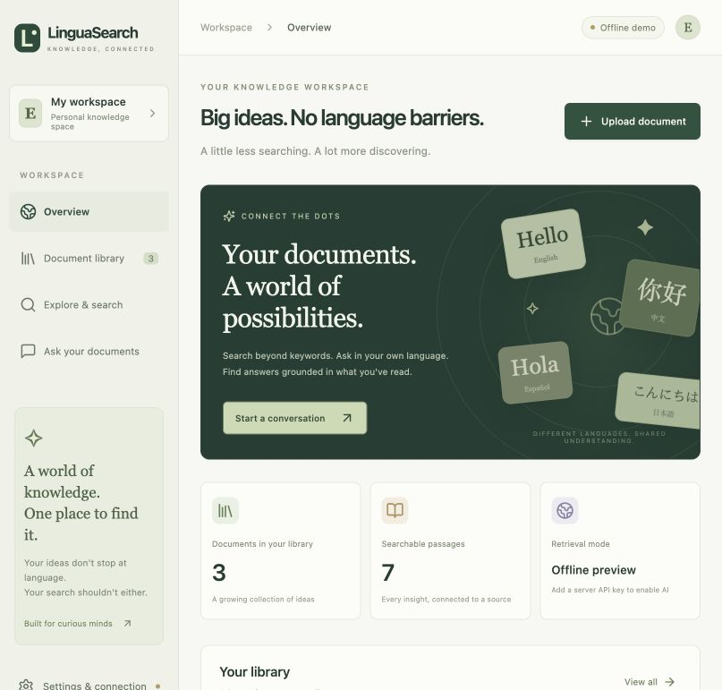
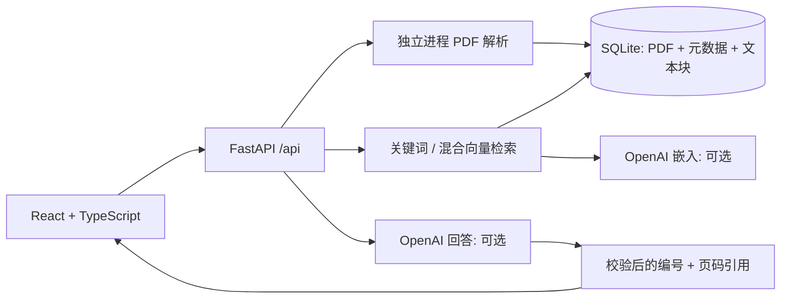

# LinguaSearch

[English](README.md) | **简体中文**

**你的文档,你的语言,可追溯的答案。**

一个全栈的文档检索与检索增强问答(RAG)工作台,基于 React、TypeScript、FastAPI 和 SQLite 构建。无需模型密钥即可启动;接入 OpenAI 后可获得多语言语义检索和带引用的回答。

[](https://github.com/tangzhemilytt-crypto/Lingua-search/actions/workflows/ci.yml)

[](docs/screenshots/desktop.jpg)

## 已实现的功能

- 响应式界面:知识概览、文档库、搜索、问答四个视图。
- 上传文本型 PDF,查看提取出的原文段落,支持重命名、下载、删除。
- SQLite 持久化保存 PDF、元数据、文本块和缓存的向量;删除文档时级联清理其全部段落。
- 按页分块(每块 1100 字符,相邻块重叠 150 字符),支持限定文档范围检索,引用可点击跳转到原文页面。
- **AI 模式:** 多语言向量嵌入 + 语义/关键词加权排序,可指定回答语言,校验引用编号;证据不足时明确说明,不编造。
- **离线模式:** 基于 Unicode 的关键词检索(包含汉字逐字匹配),直接展示原文片段。不会伪造 AI 回答,也不产生 API 费用。内置的双语示例便于体验;离线模式**不会**翻译任意查询。
- 生产环境防护:访问令牌、上传大小限制、独立进程解析 PDF、去重、限流、同源安全响应头、非 root 的 Docker 镜像,以及测试和 GitHub Actions。

## 本地运行

环境要求:Python 3.11+(在 3.13 上测试)、Node.js 24、pnpm 11.25.0。

```bash
git clone https://github.com/tangzhemilytt-crypto/Lingua-search.git
cd Lingua-search
cp .env.example .env
python3 -m venv .venv
source .venv/bin/activate
pip install -r requirements.lock
corepack enable
corepack prepare pnpm@11.25.0 --activate
cd frontend
pnpm install --frozen-lockfile
pnpm run build
cd ..
python -m uvicorn src.app:app --host 127.0.0.1 --port 8000
```

打开 [http://localhost:8000](http://localhost:8000)。首次启动会载入三份明确标注的合成示例文档,无需 API 密钥。前端开发时,在另一个终端进入 `frontend` 运行 `pnpm dev`(端口 5173,请求会代理到后端 8000 端口)。

启用 AI 功能:在 `.env` 中设置 `OPENAI_API_KEY` 并重启后端。默认模型为 `text-embedding-3-small` 和 `gpt-4.1-mini`,你的账号需要有这两个模型的权限。密钥只保存在服务端。启用 AI 后的第一次搜索,会为离线状态下已有的文档生成并缓存向量。

## 两分钟演示

1. 打开概览页,查看示例文档 “A field guide to RAG”。
2. 在“探索与搜索”中搜索 `检索`,打开匹配的页面。
3. 提问 `How does language shape identity?`,点击引用 1 跳转到原文。
4. 上传一份文本型 PDF,重命名后将其设为搜索范围。
5. 启用 AI 后,用中文提问一份英文 PDF 的内容,并思考共享向量空间是如何支持跨语言检索的。

示例文档是为演示撰写的文本,不是已发表的论文,其页码对应示例章节;上传 PDF 的引用使用真实的 PDF 页码(从 1 开始)。纯扫描件会被拒绝,并提示需要先做 OCR。

## 架构



- `src/app.py`:部署使用的应用入口。
- `src/store.py`:事务与持久化。
- `src/pdf_worker.py`:在 API 进程之外解析不可信的 PDF。
- `src/rag.py`:检索与模型调用逻辑。
- `frontend/src`:界面和带类型的 API 客户端。

> 原始教程阶段的搜索函数和 `src/api.py` 为兼容保留,并由原有测试覆盖。**请勿部署 `src.api:app`**,它是教学用的旧版 API,没有新的安全与持久化层。

检索会在进程内对最多 5000 个已存段落排序:AI 模式下得分为余弦相似度 × 85% + 查询词重叠度 × 15%,离线模式只使用词重叠度。分数只是排序信号,不是概率。AI 回答中的引用只做结构校验(编号是否属于检索结果),并不能证明每个论断都被原文支持,请查看原文段落核实。文档内容被视为不可信的上下文,回答以纯文本渲染,从不渲染模型返回的 HTML。

## 检索评测

`eval/` 目录包含一个小型标注集(12 段英文文本、24 条查询,其中 12 条英文改写、12 条中文)和评测脚本,用来比较关键词检索与混合检索:

```bash
python eval/run_eval.py                  # 关键词检索;设置了 OPENAI_API_KEY 时同时运行混合检索
python eval/run_eval.py --mode lexical   # 无需 API 密钥
```

输出 Recall@1、Recall@3 和 MRR@5。该数据集是合成的、规模很小,结果仅用于对比两种方式的相对表现,不代表真实场景的检索质量。

## 测试

```bash
# 在仓库根目录,并已激活 Python 环境
python -m pytest -q
cd frontend
pnpm test
pnpm run build
pnpm exec playwright install chromium
pnpm test:e2e
```

测试覆盖:原有搜索行为、真实 PDF 解析、上传校验、重启后的持久化、重复与并发写入、文档范围与删除、鉴权、限流、模型失败、无效引用,以及用确定性替身验证的语义检索路径;Playwright 在桌面和移动视口下运行真实应用,覆盖 Unicode 搜索、引用、空状态、设置页和无效文件上传。测试不需要付费模型密钥。真实模型的冒烟测试需要在配置密钥后由运维人员执行。

[部署指南](docs/DEPLOYMENT.md):Docker、持久化卷、生产配置、HTTPS 反向代理、备份与限制说明,以及工作区令牌和模型密钥的区别。

## 范围与后续计划

这是面向小型语料的**单工作区 MVP**,不是多租户 SaaS,所有持有令牌的人共享同一批文档。生产环境需要设置高强度令牌。GitHub Pages 无法托管 Python 后端。项目未包含 OCR 和 PostgreSQL;SQLite 满足当前版本的持久化需求。

后续计划:用户身份、pgvector、后台索引、评测数据集扩充、流式回答。
